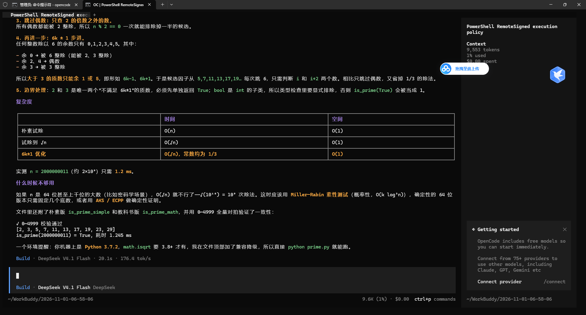

# AI-Lab 通识学习计划与环境踩坑记录

> 任务卡：Task 02 —— Markdown 规范排版与实战笔记系统搭建
> 本文包含：多级标题、表格、代码块（带语法高亮）、本地图片引用、外部参考链接、LaTeX 公式。

---

## 一、学习计划总览

通识考核周期上限 1 个月，按手册建议用时拆解如下：

| 阶段 | 任务卡 | 内容 | 建议用时 | 状态 |
|---|---|---|---|---|
| 一 | Task 01 | AI IDE + CLI 工具 + 大模型 API | 7~10 天 | ✅ 已完成 |
| 一 | Task 02 | Markdown 笔记系统 | 随 Task 01 同步 | ✅ 本文档 |
| 一 | Task 03 | Linux 终端基础 | 2 天 | ⬜ 未开始 |
| 一 | Task 04 | Git 与 GitHub 协作 | 2 天 | 🔄 进行中 |
| 一 | Task 05 | Conda 环境隔离 | 1~2 天 | ⬜ 未开始 |
| 一 | Task 06 | Docker 容器化 | 2~3 天 | ⬜ 未开始 |
| 二 | Task 07 | Python 核心语法 | 4~5 天 | ⬜ 未开始 |
| 二 | Task 08 | 文件 I/O 与异常处理 | 3 天 | ⬜ 未开始 |
| 二 | Task 09 | 洛谷算法 ≥ 6 题 | 5~7 天 | ⬜ 未开始 |
| 三 | Task 10 | 综合微项目（CLI 工具） | 3~5 天 | ⬜ 未开始 |

> 节奏原则：环境类任务（01/03/04/05/06）连续推进；Python 类任务穿插算法题巩固。

---

## 二、环境配置记录

已完成的核心环境与版本（详细过程见 [task01-env/README.md](../task01-env/README.md)）：

| 组件 | 版本 | 安装方式 |
|---|---|---|
| OpenCode CLI | v2.2.5 | `npm install -g @opencode/cli` |
| Node.js | v22.22.2 | 随系统 |
| Git | 2.56.0 | `winget install --id Git.Git` |
| DeepSeek API | deepseek-flash（默认） | OpenAI 兼容接口接入 |
| ModelScope API | GLM-5.2 / Qwen3.5 | OpenAI 兼容接口接入 |

### 关键操作命令

```bash
# 安装 OpenCode（-g 表示全局安装）
npm install -g @opencode/cli

# 验证安装：能输出版本号说明 PATH 配置正确
opencode --version

# 查看已注册模型（应包含 deepseek/* 与 modelscope/*）
opencode models
```

### 环境截图

CLI 工具在终端中成功完成一次交互（OpenCode + DeepSeek V4.1 Flash，质数判断函数讲解）：



---

## 三、踩坑记录（Troubleshooting）

以下均为搭建过程中真实发生的报错与解决过程：

### 坑 1：`opencode auth login` 选 Google 提供商后超时

- **现象**：浏览器跳转 Google OAuth 后，终端报 `connect ETIMEDOUT 64.233.188.95:443`
- **原因**：`oauth2.googleapis.com` 在国内网络不可直连
- **解决**：改用国内可直连的提供商（DeepSeek / ModelScope），通过 API Key 方式接入而非浏览器登录

### 坑 2：CMD 提示「不是内部或外部命令」

- **原因**：npm 全局安装目录不在系统 PATH 中
- **解决**：将 `npm prefix -g` 输出的目录加入用户环境变量 `Path`，并重开终端

### 坑 3：PowerShell 报「无法加载 opencode.ps1，禁止运行脚本」

- **原因**：默认执行策略为 `Restricted`
- **解决**：`Set-ExecutionPolicy -Scope CurrentUser RemoteSigned`，或直接改用 CMD

### 坑 4：ModelScope API 报错要求实名认证

- **现象**：`To use API-Inference, please make sure your associated Aliyun account is real-name verified`
- **解决**：先在 modelscope.cn 完成阿里云账号实名认证，**随后还要求完成邮箱验证**（两步缺一不可）

### 坑 5：Git 2.56 凭据助手静默失效

- **现象**：`git push` 无任何输出也不弹登录窗口
- **原因**：新版 Git for Windows 使用 `ucrt64` 目录结构，`git-credential-manager.exe` 所在目录不在 PATH
- **解决**：将 `C:\Program Files\Git\ucrt64\bin` 加入用户 PATH

### 坑 6：CMD 跨盘 `cd` 无效

- **现象**：`cd "E:\AI LAB\dev-env-setup"` 后提示符仍停留在 `C:\Users\Administrator`
- **原因**：CMD 中 `cd` 不切换盘符
- **解决**：使用 `cd /d "E:\AI LAB\dev-env-setup"`

### 坑 7：`git push` 报 `CONNECT tunnel failed, response 502`

- **原因**：部分工具环境下设了内网代理 `http://127.0.0.1:6880`，代理拒绝 git 的 CONNECT 隧道
- **解决**：在无代理的终端中直接推送

---

## 四、笔记目录体系

按手册要求建立的四类笔记目录（位于仓库 `notes/` 下）：

```text
notes/
├── env-setup/         环境配置笔记
├── troubleshooting/   排错记录
├── code-lab/          代码实验
└── reading/           文献 / 技术摘记
```

---

## 五、外部参考链接

| 资源 | 用途 |
|---|---|
| [OpenCode 官方文档](https://opencode.ai/docs/) | CLI 工具配置与提供商接入 |
| [廖雪峰 Git 教程](https://www.liaoxuefeng.com/wiki/896043488029600) | Task 04 主教材 |
| [Markdown 官方入门指南](https://markdown.com.cn/) | 语法速查 |
| [DeepSeek 开放平台](https://platform.deepseek.com/) | API 密钥与文档 |

---

## 六、LaTeX 公式示例

评估一个 O(n²) 双重循环在 1 秒内的可行规模，常用经验公式：

$$
T(n) \approx 10^8 \quad \Rightarrow \quad n_{max} = \sqrt{T(n)} \approx 10^4
$$

以及质数判断（Task 09 会用到）只需试除到 $\sqrt{n}$：

$$
k \leq \lfloor \sqrt{n} \rfloor
$$
